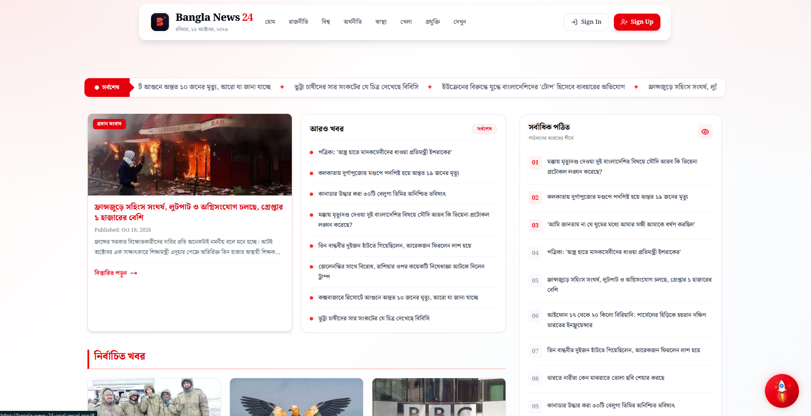

# 📰 Bangla News 24

> A modern Bangla news platform delivering category-based news through a clean interface, seamless navigation, and a reader-first experience.

[🌐 Live Demo](https://bangla-news-24-opal.vercel.app)

---

## 📸 Preview

---

## ✨ Features

- Category-Based News — Browse news by category with dynamic navigation.
- Latest Headlines — Stay updated with the latest news stories.
- Bangla Date & Localization — Display dates in the Bengali language.
- Responsive Design — Smooth experience across mobile, tablet, and desktop.
- Dynamic News Filtering — Explore news based on selected categories.
- Interactive UI — Smooth animations, scrolling headlines, and active navigation states.
- Authentication — Secure sign-up and login with email or Google.
- User Profiles — Manage account information and profile details.

---

## 🛠️ Technologies Used

### Frontend
- React
- Next.js
- TypeScript
- Tailwind CSS
- Better Auth
- Mongo DB

### Tools & Libraries
- Daisy UI
- React Router
- React Toastify
- React Icons

---
